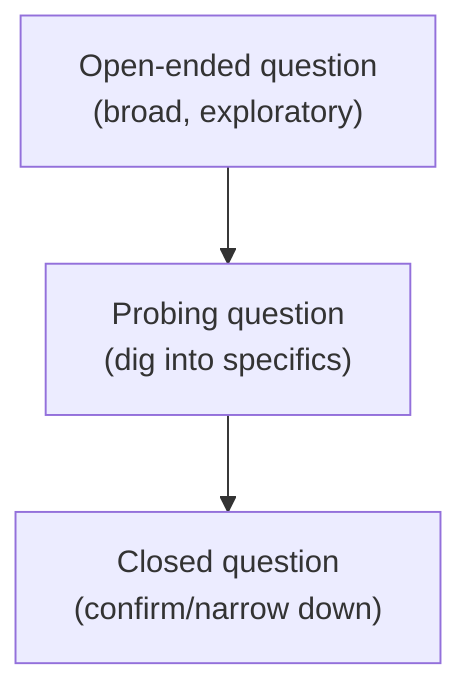
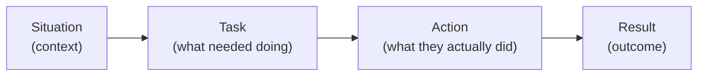

## 1. The funnel approach to questioning

Structure each topic/question area as a funnel: start broad (open-ended), then narrow (closed), rather than jumping straight to yes/no questions.

- **Open the interview** with open-ended questions.
- **Close the interview / close a topic** with closed questions, once you've gathered enough.

| Type | Purpose | Example | When to use |
|---|---|---|---|
| **Open-ended** | Let the candidate talk freely, surface what matters to them | "Tell me about a time you had to debug a tricky production issue." | Start of interview / start of a new topic |
| **Probing** | Dig deeper into something they just said | "Explain what you tried first." / "Describe what the team's reaction was." / "Tell me more about that decision." | Right after an open-ended answer, to go beyond the surface |
| **Closed** | Confirm a specific fact, narrow down, or wrap up a topic | "Did that fix ship the same day?" | End of a topic, to pin down a detail |
| **Leading** (avoid) | Suggests the "correct" answer, biases the response | "Are you comfortable working night shifts?" | Avoid — candidate just agrees instead of revealing their real view |

A leading question embeds the answer you want to hear into the question itself, so the response tells you little. Rephrase it as open/probing instead: instead of *"Are you comfortable working night shifts?"*, ask *"Tell me about your experience with different work shifts."*

Good probes use open verbs that invite elaboration rather than a yes/no: **"Tell me...", "Explain...", "Describe...", "Walk me through..."**

## 2. The KSA model

Frame interview evaluation around three dimensions, not just one:

| Dimension | What it covers | Example |
|---|---|---|
| **K — Knowledge** | Theoretical understanding, academic background, industry-specific expertise. What they know. | An architect knowing design principles, building codes/regulations, materials, construction techniques; a developer knowing Python or Java as a language. |
| **S — Skills** | Practical abilities acquired through education, training, and experience. What they can *do* with what they know. | A software engineer's actual programming ability, problem-solving, communication, presentation skills. |
| **A — Attitude** | Personal attributes and innate talents that drive effectiveness in a role. How they *approach* the work. | A marketing manager's interpersonal skills to collaborate cross-functionally, creativity for campaigns, adaptability to shifting market trends. |

**How to use it:** take the job description (JD) and derive interview questions directly from it, across all three dimensions, then ask each open-ended first and probe deeper (per §1):

| JD line | Dimension | Sample question |
|---|---|---|
| "3+ years experience with distributed systems" | Knowledge | "Tell me about the distributed systems concepts you've worked with." |
| "Must debug production incidents under pressure" | Skills | "Walk me through how you debugged a tough production issue." |
| "Works cross-functionally with design and product" | Attitude | "Describe a time you had to adapt your approach to work with a different team." |

## 3. BEI vs traditional questions

| | BEI questions | Traditional questions |
|---|---|---|
| Core question | "What **did** you do?" | "What **would** you do?" |
| Basis | Real-life examples | Hypothetical answers |
| Grounding | Evidence-based | Opinion-based |
| Predictive of performance | More predictive | Less predictive |
| Probing | Deep probing of events | Limited probing |

A hypothetical answer tells you what a candidate *thinks* they'd do — typically the idealized, socially-desirable answer. An actual past example is evidence that can be probed far more deeply, which makes it a better predictor of real performance. In practice: open with a BEI-style question ("Tell me about a time..."), pick *what* to ask about using the KSA model (§2), and structure/listen to the answer using STAR (§4).

## 4. The STAR model

A four-part structure for a candidate's answer to a behavioral question:

| Aspect | STAR |
|---|---|
| Structure | Situation → Task → Action → Result |
| Length | More detailed |
| Focus | Provides full background and responsibilities |
| Best for | Leadership, complex projects, complex scenarios |
| Interviewer insight | Better understanding of the candidate's thought process |
| Ease of use | Slightly more complex |

STAR is what you're listening for in response to a BEI question — and what to probe for if a part is missing (e.g. they describe the Situation and Action but skip the Result).

## 5. Unconscious bias during interviews

| Bias | What it is | How it shows up in an interview |
|---|---|---|
| **Confirmation bias** | Seeking/favoring information that confirms a belief you already hold ("your decisions are pre-wired") | Deciding on gut feel in the first few minutes, then unconsciously steering questions to confirm that first impression rather than test it |
| **Affect heuristic** | Letting a current emotional reaction drive the judgment, rather than the facts | A candidate's nervousness, tone, or an offhand comment colors the whole evaluation, independent of their actual answers |
| **Halo/horn effect** | One strong positive (halo) or negative (horn) trait bleeds into judging unrelated traits | A candidate who went to a prestigious school (halo) gets the benefit of the doubt everywhere else; one awkward answer (horn) taints everything after it |
| **Affinity bias** | Favoring people who resemble you — background, interests, alma mater, communication style | Rating a candidate higher simply because they remind you of yourself, not because they're better suited to the role |
| **Conformity bias** | Aligning your judgment with the group's/panel's view rather than your own independent read | Changing or softening your own assessment after hearing other interviewers' opinions, instead of recording your independent read first |
| **Gender bias** | Judging differently based on gender rather than role-relevant evidence | Holding candidates of different genders to different standards for the same behavior (e.g. assertiveness read as "confident" vs "aggressive") |

Mitigation: anchoring on KSA dimensions (§2) and evidence-based BEI questions (§3) with the STAR structure (§4) gives a concrete, comparable basis for judgment instead of gut feel — and recording your own evaluation *before* hearing the panel's view directly counters conformity bias.

## 6. BEI sample questions (Netradyne values)

A ready-reckoner mapping each Netradyne company value to sample BEI questions — pick and choose at discretion, evaluate responses with STAR (§4).

**We put honesty and integrity at the forefront of all our actions.**
- Tell me about a time you made a mistake at work. How did you resolve the problem, and what did you learn from your mistake?
- Can you describe a situation where you faced an ethical dilemma at work. What actions did you take and what was the result?
- Have you ever been asked to do something at work that you felt was unethical or against company policy? How did you handle the situation?

**We do what's right for our customers.**
- Give an example of a time when you had to make a difficult decision. How did you handle it?
- Describe a time when it was especially important to make a good impression on a client. How did you go about doing so?
- Give me an example of a time when you didn't meet a client's expectation. What happened, and how did you attempt to rectify the situation?
- Tell me about a time when you made sure a customer was pleased with your service.
- Describe a time when you had to interact with a difficult client or customer. What was the situation, and how did you handle it?
- When you're working with a large number of customers, it's tricky to deliver excellent service to them all. How do you go about prioritizing your customers' needs?

**We have a relentless search for operational excellence at scale.**
- Describe an occasion when you had to manage your time to complete a task. How did you do it?
- Give me an example of a time you managed numerous responsibilities. How did you handle that?
- Tell me about a time your responsibilities got a little overwhelming. What did you do?

**We show ownership, responsibility, and accountability.**
- Describe a time when you were responsible for a task you didn't receive training on and were unsure how to complete. How did you handle it?
- Describe a situation where you were responsible for a team or a project. How did you ensure that everything was completed on time and met quality standards?
- Can you give an example of a time when you faced a significant challenge or setback at work? How did you handle it, and what steps did you take to overcome it?
- Tell me about a time when you took ownership of a project or task that wasn't initially assigned to you. What motivated you to take it on, and what was the outcome?

**We embrace diversity and value our coworker's ideas.**
- Give me an example of a time you had a conflict with a team member. How did you handle it?
- Tell me about a time when you had to work closely with someone whose personality was very different from yours.

**We Innovate, it's in our blood.**
- Describe a time when you were the resident technical expert. What did you do to make sure everyone was able to understand you?
- Describe a situation where you challenged the status quo or proposed a new way of doing things. How did you present your idea, and what was the result?
- Can you give an example of a project or initiative where you had to think creatively to achieve your goals? What specific steps did you take to foster innovation?

**We are curious, we test and let data drive our path.**
- Describe your process for solving problems. What steps do you take to resolve important issues at work?
- Describe a situation where you asked questions or sought out information to better understand a complex issue at work. How did your curiosity help you or your team achieve a better outcome?

**We launch fast and iterate at Netradyne speed.**
- Give me an example of a time when you had to think on your feet.
- Describe a long-term project that you kept on track. How did you keep everything moving?

**We win more working together.**
- Tell me about a time you needed to get information from someone who wasn't very responsive. What did you do?
- Describe a situation where you had to work with a colleague who had a different working style or perspective than yours. How did you handle it, and what was the outcome?
- Give me an example of a time when you were able to successfully persuade someone at work to see things your way.

**We approach our work with the mission to create solutions that save lives.**
- Talk about an initiative that you spearheaded or contributed that had a direct impact on the company's mission.

## Source

Netradyne internal "Best Interviewing Techniques" training (Nov 17, 2026): dictated notes on questioning technique, plus photographed slides ("KSA Model for Interviewing", "Comparison" [BEI vs Traditional], "The STAR model!", "Unconscious Bias during Interviews") and a 3-page interviewer handout ("BEI Sample Questions").
