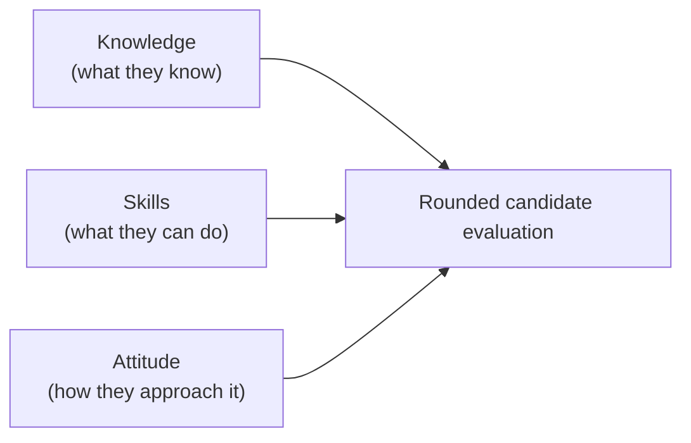

## The three dimensions

| Dimension | What it covers | Example |
|---|---|---|
| **K — Knowledge** | Theoretical understanding, academic background, industry-specific expertise. What they know. | An architect knowing design principles, building codes/regulations, materials, construction techniques; a developer knowing Python or Java as a language. |
| **S — Skills** | Practical abilities acquired through education, training, and experience. What they can *do* with what they know. | A software engineer's actual programming ability in Python/Java, problem-solving, communication, presentation skills. |
| **A — Attitude** | Personal attributes and innate talents that drive effectiveness in a role. How they *approach* the work. | A marketing manager's interpersonal skills to collaborate cross-functionally, creativity for campaigns, adaptability to shifting market trends. |

## Why it matters

Knowledge and skills are the easy, checkable parts of an interview (can they name the concept, can they demonstrate the ability). Attitude is the one most often skipped, but it's what determines whether the knowledge/skill actually gets applied well in the team context — captured here via Netradyne's own training slide.

## How to use the model

Take the job description (JD) and derive interview questions directly from it, split across the three dimensions:

1. Pull out the JD's required knowledge areas, skills, and (implicitly) the attitudes the role needs → write at least one question per dimension.
2. Ask each as an open-ended question first, then [[interviewing/question-techniques|probe]] deeper on the answer.

| JD line | Dimension | Sample question |
|---|---|---|
| "3+ years experience with distributed systems" | Knowledge | "Tell me about the distributed systems concepts you've worked with." |
| "Must debug production incidents under pressure" | Skills | "Walk me through how you debugged a tough production issue." |
| "Works cross-functionally with design and product" | Attitude | "Describe a time you had to adapt your approach to work with a different team." |

## Related

- [[interviewing/question-techniques|Interview Questioning Techniques — The Funnel Approach]] — the questioning technique used to actually surface K, S, and A in an interview.

## Source

Netradyne internal "Best Interviewing Techniques" training, slide "KSA Model for Interviewing" (photographed Nov 17, 2026).
