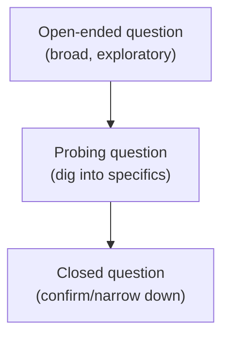

## The funnel approach

Structure each topic/question area as a funnel: start broad (open-ended), then narrow (closed), rather than jumping straight to yes/no questions.

- **Open the interview** with open-ended questions.
- **Close the interview / close a topic** with closed questions, once you've gathered enough.

## Question types

| Type | Purpose | Example | When to use |
|---|---|---|---|
| **Open-ended** | Let the candidate talk freely, surface what matters to them | "Tell me about a time you had to debug a tricky production issue." | Start of interview / start of a new topic |
| **Probing** | Dig deeper into something they just said | "Explain what you tried first." / "Describe what the team's reaction was." / "Tell me more about that decision." | Right after an open-ended answer, to go beyond the surface |
| **Closed** | Confirm a specific fact, narrow down, or wrap up a topic | "Did that fix ship the same day?" | End of a topic, to pin down a detail |
| **Leading** (avoid) | Suggests the "correct" answer, biases the response | "Are you comfortable working night shifts?" | Avoid — candidate just agrees instead of revealing their real view |

## Why avoid leading questions

A leading question embeds the answer you want to hear into the question itself, so the candidate's response tells you little — they'll often just agree. Rephrase it as open/probing instead: instead of *"Are you comfortable working night shifts?"*, ask *"Tell me about your experience with different work shifts"* or *"Walk me through how you'd handle a night-shift rotation."*

## Probing-question starters

Good probes use open verbs that invite elaboration rather than a yes/no:
- "Tell me..."
- "Explain..."
- "Describe..."
- "Walk me through..."

## Applying this to the KSA model

The funnel/open/probing/closed structure here is *how* you ask questions; [[interviewing/ksa-model|the KSA model]] is *what* you ask questions about — use open-ended + probing questions to draw out a candidate's Knowledge, Skills, and Attitude, then use closed questions to confirm specifics before moving on.

## Related

- [[interviewing/ksa-model|KSA Model for Interviewing]]
- [[interviewing/bei-vs-traditional|BEI vs Traditional Interview Questions]] — the open/probing question in practice is usually a BEI question
- [[interviewing/star-model|STAR Model for Structuring Answers]]
- [[interviewing/unconscious-bias|Unconscious Bias During Interviews]]
