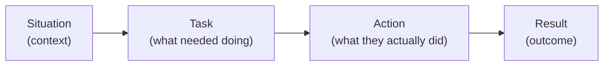

## The structure

## At a glance

| Aspect | STAR |
|---|---|
| Structure | Situation → Task → Action → Result |
| Length | More detailed |
| Focus | Provides full background and responsibilities |
| Best for | Leadership, complex projects, complex scenarios |
| Interviewer insight | Better understanding of the candidate's thought process |
| Ease of use | Slightly more complex |

*(The "Best For" and "Interviewer Insight" cells were partially obscured in the source photo — reconstructed from the visible fragments; worth double-checking against the original deck.)*

## How this connects

STAR is the *answer structure* for a [[interviewing/bei-vs-traditional|BEI question]] — when you ask "tell me about a time you...", STAR is what you're listening for in the response (and what you should probe for if a part is missing, e.g. they describe the Situation and Action but skip the Result).

## Related

- [[interviewing/bei-vs-traditional|BEI vs Traditional Interview Questions]]
- [[interviewing/question-techniques|Interview Questioning Techniques — The Funnel Approach]]
- [[interviewing/unconscious-bias|Unconscious Bias During Interviews]]

## Source

Netradyne internal "Best Interviewing Techniques" training, slide "The STAR model!" (photographed Nov 17, 2026).
